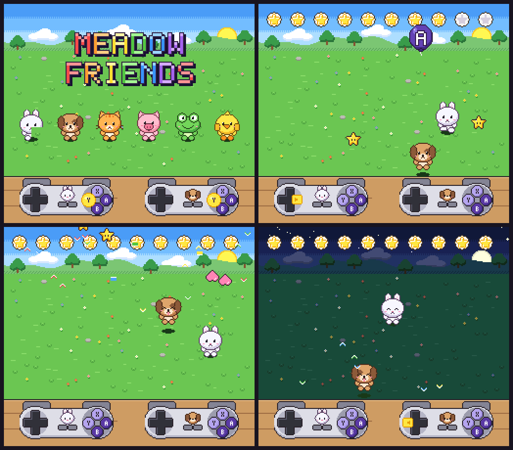

# Meadow Friends

A first Super Nintendo game for small kids, made to play on a MiSTer (it also
runs in any accurate SNES emulator). Two players, no reading, nothing to lose.



`meadow-friends.sfc` in this folder is the latest build, ready to copy.

## Putting it on the MiSTer

Copy `meadow-friends.sfc` to the SD card under `games/SNES/`
(`/media/fat/games/SNES/`). Start the SNES core and pick the file.

## Playing

- **Title screen:** any button starts. The other controller can join at any
  time by pressing any button; its controller picture blinks until then.
- **D-pad:** walk your animal. Walk into fruit and stars to collect them.
- **Balloons:** a balloon floats down to your animal showing A, B, X or Y.
  Press that button to pop it. The matching button blinks on your on-screen
  controller, in the same spot as on the real pad.
- **Stars:** every pickup and every pop adds a star to the top bar. Ten stars
  start a party: confetti, a little tune, the animals dance, and the sky
  moves on from day to sunset, night and morning.
- **Every other button does something:** A/B/X/Y make your animal hop with
  its own note when there's no balloon. L, R and Start hop too. Select
  switches your animal (bunny, puppy, kitty, piggy, frog, chick), and the
  face on your controller picture changes with it.

## How the balloons adapt

Each player is tracked separately, with no settings to change:

- At first balloons only ask for **A**. A wrong button makes the balloon
  wiggle with a soft "boing". After two wrong presses, the next press of
  any button pops it.
- Three first-try pops in a row add a new button (A → B → Y → X), and each
  first-try pop makes the game allow one more wrong press, up to three.
- Balloons popped by mashing make it more forgiving, until any button pops
  them straight away.

So a careful 5-year-old gets asked for more buttons, and a 3-year-old who
mashes gets "any button works".

## Building

Needs `cc65` (ca65/ld65) and Python 3 with Pillow.

```
./build.sh          # -> build/meadow-friends.sfc
```

| Path | What it is |
| --- | --- |
| `src/main.s` | the game, 65816 assembly |
| `src/snes.cfg` | ROM/RAM memory map (LoROM, 128 KB) |
| `tools/gen.py` | all art, palettes and maps, drawn in code |
| `tools/spc.py` | sound driver for the SNES audio CPU, instruments, samples |
| `tools/checksum.py` | fixes the cartridge header checksum |
| `tools/run.py` | headless test runner using libretro bsnes/snes9x cores |

`./build.sh` also refreshes `build/meadow-friends.sfc`; copy it over
`meadow-friends.sfc` when you want to update the checked-in ROM. To see a
party without collecting ten stars, assemble with `-D TEST_PARTY` (starts at
nine stars).

`tools/run.py` takes screenshots, records audio and can press buttons on
given frames. `--bot build/labels.txt` plays automatically: player 1 plays
well and player 2 mashes buttons like a toddler. Debian/Ubuntu packages:
`cc65 libretro-bsnes-mercury-accuracy libretro-snes9x`.
